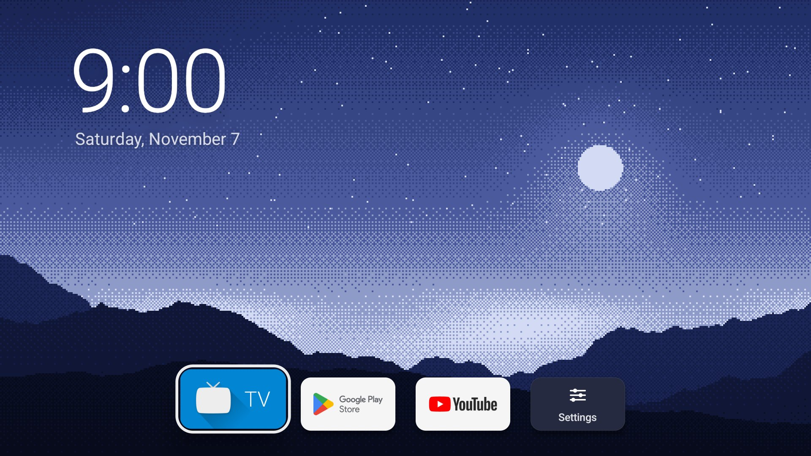
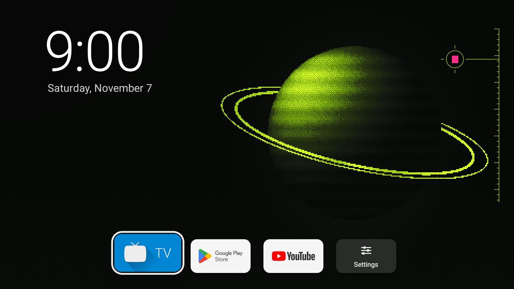
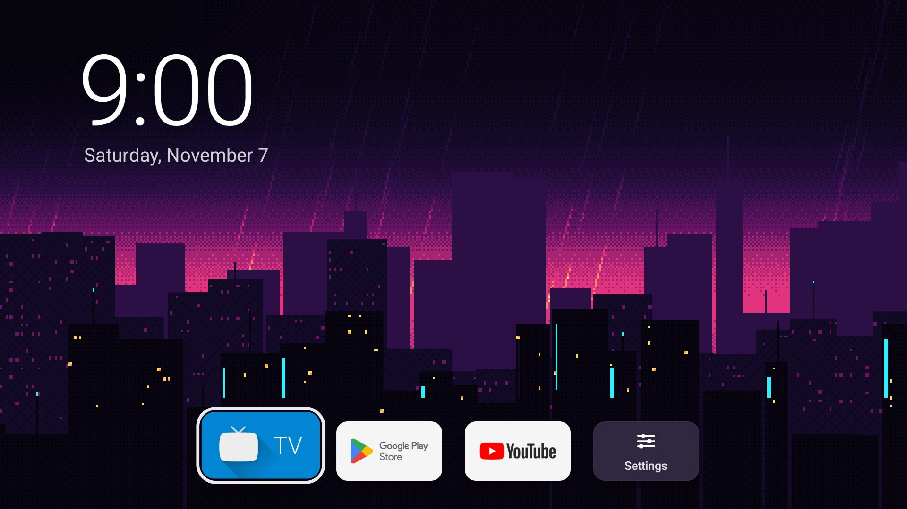
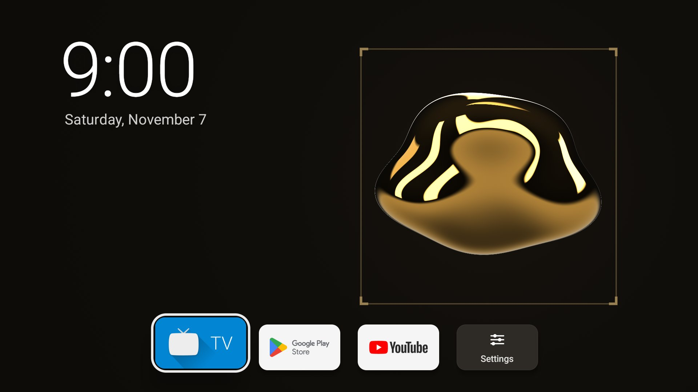
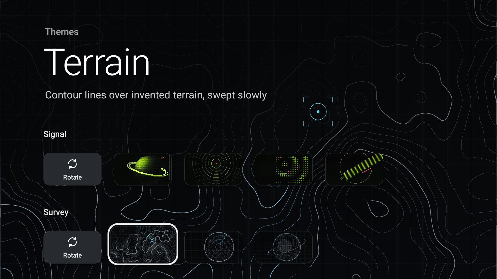

# Gallery

A quiet home screen for Google TV. A large clock, a row of app banners, and a full-screen
generative background in place of the stock launcher's ads and recommendations.

| | |
| --- | --- |
|  |  |
|  |  |

**[See all 19 backgrounds and the theme picker →](gallery.md)**

## Themes

19 backgrounds in five packs, all drawn on the device. Nothing is downloaded.

| Pack | Backgrounds | How it's drawn |
| --- | --- | --- |
| Gallery | Ridge, Dunes, Sea, Planet, Sky | Ordered dither on the CPU; colours follow the time of day |
| Signal | Orbit, Beacon, Array, Stripe | Dither, acid green on black with one pink accent |
| Survey | Terrain, Radar, Globe | OpenGL ES 3 shader, fine contour and line work |
| Neon | Skyline, Highway, Sign, Window | Dither, purple to magenta with one cyan accent |
| Metal | Chrome, Gold, Alloy | OpenGL ES shader, reflective metal in a procedural studio |

To choose one, hold OK on the Settings tile and pick **Themes**. Each pack can also rotate through
its backgrounds every 1, 3, 6 or 24 hours, and **Shuffle** rotates through every pack in random
order. Planet can be picked on its own but isn't part of any rotation.

Hold OK on any app to move or hide it; hidden apps come back from the same Settings-tile menu.



## Build

Needs JDK 17 and the Android SDK (set `sdk.dir` in `gallery-launcher/local.properties`, or
`ANDROID_HOME`). The wrapper script is for macOS and Linux.

```bash
(cd gallery-launcher && ./gradlew assembleDebug)
```

The APK is written to `gallery-launcher/app/build/outputs/apk/debug/app-debug.apk`.

## Install on a TV

Turn on Developer options and USB or network debugging on the TV, connect with adb (the TV asks
you to allow the connection the first time), and install:

```bash
adb connect <tv-ip>:5555
```

```bash
adb install -r gallery-launcher/app/build/outputs/apk/debug/app-debug.apk
```

Google TV doesn't offer a choice of home app, so Gallery only becomes the home screen once the
stock launcher is turned off. This disables it for the TV's main user; nothing is uninstalled:

```bash
adb shell pm disable-user --user 0 com.google.android.apps.tv.launcherx
```

> [!WARNING]
> With the stock launcher off, Gallery is the only home screen. Keep debugging on until you're
> happy with it, and turn the stock launcher back on **before** uninstalling Gallery, or the TV is
> left without a home screen until you reconnect with adb:
>
> ```bash
> adb shell pm enable --user 0 com.google.android.apps.tv.launcherx
> ```

`gallery-launcher/tv-undo.sh <tv-ip>:5555` is a fuller undo for the TCL TV this was built on: it
turns the stock launcher back on, re-enables a fixed list of TCL and Google apps that were turned
off there, and resets the system animation speeds. Read its package list before running it on
anything else.

Tested on one TCL Google TV (MediaTek MT5896, Mali-G52, 1080p interface) and the Android TV
emulator. The GPU backgrounds hold their 30 fps cap on that TV.

## Development

Debug builds accept preview extras, which never change the saved theme:

```bash
adb shell am start -n co.thetylerreiff.gallery/.MainActivity --es scene GOLD --ef hour 21
```

- `--es scene <NAME>|none` shows a background by its name in `SceneView.Scene`, which is the title
  in capitals except for three: Orbit is `SIGNAL`, Skyline is `NEON` and Terrain is `SURVEY`. `none`
  ends the preview.
- `--ef hour <0–24>|-1` fixes the time of day; `-1` returns to the clock.
- `--es demo themes --ei focus <n>` opens the picker with tile `n` focused.
- `--ez uncapped true` lets GPU backgrounds draw as fast as they can and logs the frame rate.

Code is in `gallery-launcher/app/src/main/java/co/thetylerreiff/gallery/`:

| File | What it does |
| --- | --- |
| `MainActivity.kt` | Home screen: clock, app row, menu, moving and hiding apps |
| `ThemesActivity.kt` | Theme picker |
| `Themes.kt` | Packs, rotation and shuffle |
| `Backdrop.kt` | Switches between the dithered and GPU backgrounds |
| `SceneView.kt` | Dithered backgrounds |
| `MetalGl.kt`, `MetalView.kt` | Metal backgrounds and the GPU surface |
| `SurveyGl.kt` | Survey backgrounds |
| `Apps.kt` | Installed apps, row order, hidden apps and saved settings |
| `Sheet.kt` | The launcher's own menus |
| `Tiles.kt` | Tile focus and colours shared by the home screen and picker |

## Licence

MIT. See [LICENSE](LICENSE).
